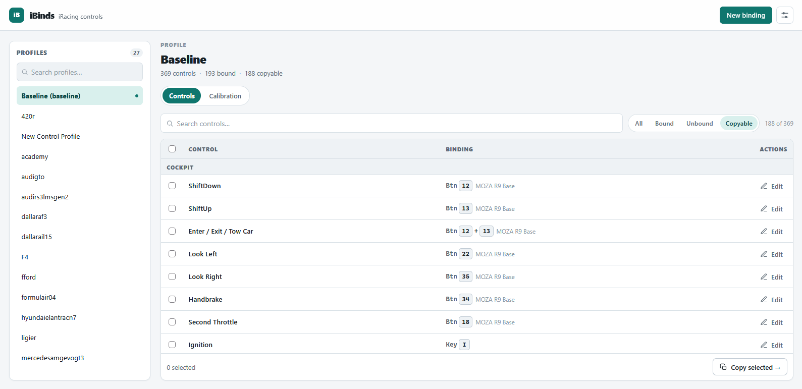

# iBinds

[](https://github.com/IanBertolucci/ibinds/actions/workflows/ci.yml)

iBinds edits iRacing control bindings in bulk and copies calibration between
control profiles — without opening the simulator. It reads the local
`controls.cfg` (binary) and `joyCalib.yaml` (YAML) files under
`Documents/iRacing/profiles/controls/`, applies surgical edits to only the
target record's fields, and keeps everything else byte-for-byte intact.

<p align="center">
  
</p>

## Motivation

iRacing stores control bindings in a baseline profile and in per-car profiles.
That split is useful: each car can keep its own force feedback and button
layout. But it also means a single change — for example, assigning a function
to the wheel's P/L button — has to be repeated manually in every relevant car
profile, and using only the baseline does not work for cars that must keep
their specific settings.

iBinds was built to remove that manual work. It reads the local configuration
files and lets you apply a binding across many profiles or copy a binding from
one car to other cars, while preserving the differences that should stay.

### Is it for you?

iBinds is useful if you:

- keep per-car profiles with different bindings or force feedback;
- change wheels or button boxes and need to update a binding across many cars;
- want to copy calibration from one profile to others without recalibrating
  every car;
- prefer editing bindings with the simulator closed.

You probably do not need iBinds if you:

- use a single baseline profile for every car;
- change bindings rarely and are comfortable doing it in iRacing;
- want help tuning force feedback or editing calibration values — iBinds only
  copies `joyCalib.yaml` unchanged.

## Features

- **Profile-centric UI**: browse and search every profile, filter controls
  (all/bound/unbound/copyable), and see the current key or button binding —
  including multi-button bindings.
- **Bulk binding**: pick a control and a key or device button, select any set
  of profiles (baseline included), preview a per-profile diff, and apply. When
  you edit from a profile, only that profile is preselected.
- **Default device**: choose the device that should be preselected when you
  assign a new key or button (Settings → Default device).
- **Copy bindings**: select controls and copy the exact binding region to other
  profiles. Multi-button masks are preserved.
- **Friendly names**: control labels use the same names shown on the iRacing
  controls screen where a mapping is known; special keys such as F1–F12,
  numpad keys, Pause, and Print Screen are shown by name. Unmapped controls keep
  their technical ID.
- **Category dividers**: controls are grouped by iRacing's in-game sections
  (Cockpit, Driver's View, Interface, Black Box, …), including the setup
  subheadings (Brakes, Engine & Throttle, …). The search box also matches
  section names, so typing `cockpit` or `brakes` filters to that section.
- **Conflict detection**: warns when the key/button is already bound to another
  control in a profile (iRacing silently resolves such conflicts on load —
  iBinds surfaces them first).
- **Calibration copy**: preview and copy a whole `joyCalib.yaml` from one
  profile to many. Calibration values are never edited.
- **Safety**: writes are blocked while the simulator is running
  (`iRacingSim64DX11.exe`), a timestamped backup is made before every write, and
  the `CCFG` magic is validated before any edit.
- **Local only**: a single binary starts an HTTP server on `127.0.0.1` with a
  per-session token and opens the browser with an embedded Svelte UI.

## Install (Windows)

1. Open the [latest release](https://github.com/IanBertolucci/ibinds/releases/latest).
2. Download `ibinds.exe` and `SHA256SUMS.txt`.
3. Verify the download:

   ```powershell
   Get-FileHash .\ibinds.exe -Algorithm SHA256
   Get-Content .\SHA256SUMS.txt
   ```

   The two hashes must match.
4. Run `ibinds.exe` (double-click it, or run it from PowerShell). It starts a
   local server, prints a URL, and opens the UI in your browser. If the browser
   does not open, open the printed URL yourself.

iBinds is portable: no installer, no administrator rights, and no runtime to
install. It only modifies the iRacing profiles folder and its own settings/log
files under `%APPDATA%\ibinds` (on Linux, `$XDG_CONFIG_HOME/ibinds`).

iBinds reads the profiles that iRacing has already created. If the profiles
folder is empty, start iRacing once and save a control profile first.

### Windows SmartScreen

The binary is not code-signed, so Windows SmartScreen may show a warning. Do
not disable SmartScreen. Verify the SHA-256 checksum and, if you use the GitHub
CLI, the build provenance:

```powershell
gh attestation verify .\ibinds.exe --repo IanBertolucci/ibinds
```

If Windows shows "Windows protected your PC", choose **More info → Run anyway**
only after the checksum matches.

Every release is built by GitHub Actions from the tagged source. If you prefer
not to trust the prebuilt binary, build it yourself from the source archive.

## Build from source

Requirements:

- Target: Windows 10/11 (iRacing is Windows-only).
- Build host: Windows or Linux/WSL with `build.sh`.
- Go 1.27.2+ (see `go.mod`).
- Node.js 20.19+ or 22.12+ (required by Vite 8).

Download the source zip from the release (or clone the repository and check out
the tag), then run:

```powershell
powershell -NoProfile -ExecutionPolicy Bypass -File .\build.ps1
```

The script installs the web dependencies, builds the SPA, and builds
`ibinds.exe` in the repository root. To include a version string:

```powershell
powershell -NoProfile -ExecutionPolicy Bypass -File .\build.ps1 -Version v0.1.0
```

From Linux or WSL:

```bash
./build.sh                 # builds web/ then cross-compiles ibinds.exe
VERSION=v0.1.0 ./build.sh  # optional version metadata
```

`build.sh` finds Go via `$PATH` or `~/.local/go/bin/go` (override with
`GO_BIN=/path/to/go`). If a copy already exists at `%USERPROFILE%\ibinds.exe`
(the one you double-click), it stops a running instance and refreshes
that copy.

## Usage

Double-click `ibinds.exe` (or run from a terminal). It starts a local server,
prints a URL, and opens your browser. The token in the URL authenticates the
session.

CLI flags:

```
--dir DIR           override the profiles directory (default: auto-detected)
--list-profiles     list detected profiles and exit
--token TOKEN       fix the session token (default: random per run)
--port PORT         port to listen on (default: 0 = ephemeral)
--capture           capture a button press and exit (DirectInput test)
--no-browser        do not open the browser on startup
--version           print version and exit
--log FILE          log file path (default: user config dir/ibinds/ibinds.log)
```

Use the settings icon to change the profiles directory and choose the default
device. The default device is preselected when you assign a new key or button;
if it is not connected, the first available device is used. Settings are stored
in `%APPDATA%\ibinds\config.json`.

The profiles directory is resolved in this order: `--dir` flag,
`IBINDS_PROFILES_DIR` environment variable, the saved config file, or the
default `Documents/iRacing/profiles/controls`.

Logs go to stderr and the log file (on Windows,
`%APPDATA%\ibinds\ibinds.log`; on Linux, `$XDG_CONFIG_HOME/ibinds/ibinds.log`).
The file is rotated at 5 MB to `ibinds.log.old`. Each API request is logged with
method, path, status, duration, and the error body for 4xx/5xx; the session
token is never logged.

## Development

Backend (starts the server on port 8791 with a fixed `dev` token):

```bash
go run ./cmd/ibinds --token dev --port 8791
```

Frontend (Vite dev server, proxies `/api` to the backend above):

```bash
cd web
npm install --legacy-peer-deps   # npm 10.8.x needs --legacy-peer-deps
npm run dev
```

Tests:

```bash
go test ./...            # backend unit tests (run on Linux)
cd web && npx vitest run # frontend unit tests
```

The same checks run in GitHub Actions on every push and pull request.

## Releases

The release workflow `.github/workflows/release.yml` runs when a `v*` tag is
pushed. It builds and tests both sides, cross-compiles `ibinds.exe` with version
metadata, writes `SHA256SUMS.txt`, attests build provenance, and publishes:

- `ibinds.exe`
- `SHA256SUMS.txt`
- GitHub's automatic source archives (`Source code (zip)` and
  `Source code (tar.gz)`)

See [`docs/RELEASING.md`](docs/RELEASING.md) for the maintainer checklist.

## Binary format

`controls.cfg` decoding is documented in [`docs/FORMAT.md`](docs/FORMAT.md),
validated against real fixtures captured from the author's profiles.

## License

MIT — see [LICENSE](LICENSE).
